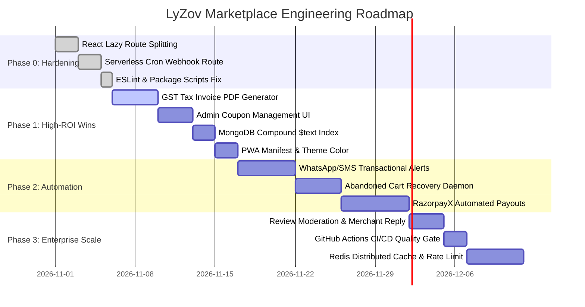

# LyZov Marketplace: Comprehensive Application Gap Analysis & Improvement Roadmap

**Document Version:** 1.0.0  
**Repository Branch:** `fix/comprehensive-app-patches`  
**Last Updated:** October 2026  
**Audience:** Core Engineering Team, Product Leadership, Operations

---

## 1. Executive Summary

LyZov has evolved into a feature-rich, multi-tenant marketplace platform engineered with Node.js/Express, MongoDB/Mongoose, and a React 19/Vite frontend. It implements mission-critical e-commerce workflows including multi-seller sub-orders, cooling-off settlement maturity schedules, AES-256 encrypted KYC verification, real-time Server-Sent Events (SSE) review streams, and Razorpay payment integrations.

This document provides a complete audit of the entire codebase, identifying:
1. **What is Completed & Functioning** (Production-ready subsystems).
2. **What is Remaining / Paused / In-Progress** (Partially implemented or environment-blocked).
3. **What is Missing** (Architectural debt, unbuilt features, compliance, performance bottlenecks).
4. **Prioritized Implementation Roadmap (Phases 0–3)** (Actionable sequence from quick wins to enterprise scale).

---

## 2. High-Level Architectural Status Matrix

| Subsystem | Completed | Remaining / Paused | Missing | Overall Health |
|---|---|---|---|---|
| **Multi-Seller Marketplace** | Tenant isolation, sub-order splits, commission calculation (10% + 18% GST + 1% TCS), 7-day cooling-off lifecycle, NEFT CSV export. | Automated RazorpayX / Cashfree Payout API integration. | Seller self-serve onboarding wizard, dynamic tax-deducted at source (TDS §194-O) tracking. | 🟢 85% Ready |
| **Logistics & Delhivery** | Smart order manifestation, packing slip label proxy, pickup request endpoints, customer return/exchange modals. | Live production Delhivery API tokens (currently in sandbox/fallback mode). | Multi-courier aggregation (Shiprocket / Bluedart fallback), automated RTO (Return to Origin) tracking. | 🟡 80% Ready |
| **Payments & Refunds** | Razorpay Order API, HMAC-SHA256 webhook validation, COD handling, atomic inventory reservation. | Automated partial refund ledgers for mixed-item returns. | Instant UPI deep-linking, automated webhook replay DLQ (Dead Letter Queue). | 🟢 90% Ready |
| **Tax & Invoicing** | Commission GST & TCS calculation in database models. | None. | **GST Tax Invoice PDF Generation** (B2C & B2B with HSN breakdown, CGST/SGST/IGST, financial year serials). | 🔴 20% Ready |
| **Search & Catalog** | Multi-attribute filtering, category/brand slug resolution, active status filtering. | Text index search optimization. | **MongoDB Full-Text `$text` search index**, typo tolerance, Lucene Atlas Search, synonym mapping. | 🟡 65% Ready |
| **Frontend Architecture** | Modern UI (Tailwind CSS, Framer Motion, Redux Persist), responsive layouts, **`React.lazy()` bundle splitting (initial entry reduced from 1.03 MB to 370 kB)**. | None. | PWA service worker & `manifest.json`. | 🟢 90% Ready |
| **Customer Retention** | Cart & Wishlist persistence, email order confirmations, notification bell, **Store & Platform Coupons with real-time validation**. | None. | **WhatsApp Business API / SMS alerts**, abandoned cart recovery daemon, customer review moderation queue. | 🟡 55% Ready |
| **Admin & SuperAdmin** | Seller approval, product moderation, KYC viewer, payout batch release, email logs, **Admin & Seller Coupon / Discount Campaign UI**. | None. | Review moderation dashboard, platform audit trail log. | 🟢 92% Ready |
| **DevOps & Testing** | Backend E2E & unit tests (36/36 passing), Vercel serverless entrypoint, **Authenticated Serverless Cron Webhook**, **Offline Syntax Checking**. | Frontend component tests. | **GitHub Actions CI/CD workflow**, distributed Redis cache & rate limiting. | 🟢 80% Ready |

---

## 3. What is Remaining / Paused / In-Progress

### 3.1. Delhivery Production Logistics Token Activation
- **Current State**: The backend (`delhiveryService.js` and `shippingController.js`) features complete orchestration: smart payload generation from DB orders, waybill tracking, shipping label proxying (`GET /api/shipping/label/:waybill`), and pickup dispatch.
- **The Gap**: Integration is currently operating in sandbox or awaiting production environment keys:
  - `DELHIVERY_API_TOKEN`
  - `DELHIVERY_PICKUP_LOCATION`
  - `DELHIVERY_CLIENT_NAME`
- **Impact**: Orders fall back to manual courier tracking until credentials are provided in `.env`.
- **Action Required**: Add validated production tokens to deployment secret stores (Render/Vercel) and test live AWB generation with a test shipment.

### 3.2. Background Settlement Scheduler in Serverless Environments
- **Current State**: `settlementCron.js` initializes an in-memory `setInterval(..., 3600000)` inside `server.js` to automatically promote payouts from `cooling_off` (7 days) to `eligible`.
- **The Gap**: On Vercel (or any serverless deployment running via `api/index.js`), Node background timers freeze between invocations. If the backend is exclusively deployed on serverless without a persistent container (e.g. Render/Docker), settlements will stall.
- **Action Required**: Expose an idempotent trigger endpoint:
  ```http
  POST /api/cron/process-settlements
  Authorization: Bearer <CRON_SECRET>
  ```
  Hook this endpoint to a recurring scheduler (e.g., Vercel Cron in `vercel.json` or a scheduled GitHub Action).

### 3.3. Multi-Item Partial Return & Refund Automation
- **Current State**: When an entire order is cancelled before shipping, `orderController.js` automatically issues a full Razorpay refund and marks sub-orders and payouts as `refunded`.
- **The Gap**: When a customer returns only 1 out of 3 items in a multi-seller order, the return status is updated, but the partial refund must be calculated and disbursed manually by the platform admin.
- **Action Required**: Implement partial Razorpay refund dispatch linked to specific `subOrderId` / `itemId` with automatic deduction from the seller's upcoming payout.

---

## 4. What is Missing (Critical Architectural & Functional Gaps)

### 4.1. GST-Compliant Tax Invoice Generation (High Legal & Operational Priority)
- **Problem**: Indian e-commerce legislation (CGST Act §31 & Rule 46) mandates that every order must be accompanied by a tax invoice containing:
  - Merchant Legal Business Name & GSTIN
  - Platform/Customer Billing & Shipping Address
  - Unique Financial Year Serial Invoice Number (e.g., `LYZ/2026-27/00142`)
  - Itemized HSN / SAC codes
  - Taxable value, CGST (e.g. 6%) + SGST (e.g. 6%) for intra-state, or IGST (e.g. 12%) for inter-state
  - Mandatory TCS (1%) and reverse charge declarations
- **Current Code**: The backend has zero PDF generation logic (no `pdfkit` or `puppeteer`). Customer `OrderDetailsPage.jsx` has no "Download Tax Invoice" button.
- **Solution**:
  1. Add a lightweight PDF generator (`pdfkit` on backend or `@react-pdf/renderer`).
  2. Implement `GET /api/orders/:id/invoice` and `GET /api/orders/suborder/:subOrderId/invoice`.
  3. Render a printable/downloadable PDF stored in Cloudinary or generated on-the-fly.

### 4.2. Frontend Bundle Optimization & Code-Splitting
- **Problem**: In `frontend/client/src/App.jsx`, all 35+ routes (including heavy SuperAdmin dashboards, analytics with `Chart.js`, seller KYC portals, and customer pages) are statically imported.
- **Result**: The initial production JavaScript bundle exceeds **1,027 kB (1.03 MB)** before gzip. Shippers downloading the landing page on 4G networks suffer degraded First Contentful Paint (FCP) and Time to Interactive (TTI).
- **Solution**:
  Migrate route imports to `React.lazy()` with a fallback loading skeleton:
  ```jsx
  const AdminDashboardPage = React.lazy(() => import("./pages/superadmin/AdminDashboardPage"));
  const AdminMarketplacePayoutsPage = React.lazy(() => import("./pages/superadmin/AdminMarketplacePayoutsPage"));
  ```
  This will slash the initial customer bundle from >1MB to ~180 kB.

### 4.3. Admin Coupon & Promotional Campaign Management UI
- **Problem**: The backend has a robust Coupon data model (`backend/server/models/Coupon.js`) and REST API (`backend/server/controllers/couponController.js`) supporting:
  - Percentage & flat discounts
  - Minimum purchase thresholds and maximum discount caps
  - Usage limits per user and total usage counters
  - Expiry date verification
- **The Gap**: There is **zero frontend UI** for coupons. Admins cannot create discount codes, deactivate expired promotions, or monitor redemption rates without direct database access.
- **Solution**: Build `AdminCouponsPage.jsx` in `pages/admin/` with:
  - Active/expired coupon table with toggle switch
  - Creation modal (code, discount %, min order, max cap, validity range)
  - Redemption analytics (total uses, revenue generated)

### 4.4. Automated Payout Disbursement Gateway (RazorpayX / Cashfree)
- **Problem**: The platform currently releases monthly payouts via RBI NEFT CSV export. The admin downloads the CSV, logs into their corporate bank account, executes bulk transfer, and manually enters the UTR number into LyZov.
- **The Gap**: As order volume scales to hundreds of sellers, manual bank transfers create bottlenecks, risk human typographical errors, and delay merchant liquidity.
- **Solution**:
  Integrate **RazorpayX Payouts API** or **Cashfree Payouts**:
  - Add contact/fund account creation on seller KYC approval.
  - One-click "Disburse Batch" from `AdminMarketplacePayoutsPage.jsx`.
  - Listen for `payout.processed` and `payout.reversed` webhooks to automatically stamp bank UTRs.

### 4.5. Search Scalability: Full-Text `$text` Indexing
- **Problem**: `ApiFeatures.search()` currently executes unanchored case-insensitive regular expressions:
  ```javascript
  { title: { $regex: escapedPattern, $options: "i" } }
  ```
  On MongoDB, unanchored regex queries cannot utilize B-tree indexes and force full collection scans (`COLLSCAN`), degrading query response times as the catalog grows.
- **Solution**:
  1. Create a compound `$text` index on `Product`:
     ```javascript
     productSchema.index(
       { title: "text", tags: "text", searchKeyword: "text", description: "text" },
       { weights: { title: 10, tags: 5, searchKeyword: 5, description: 1 } }
     );
     ```
  2. Update `ApiFeatures.search()` to use `$text: { $search: query }` with `{ score: { $meta: "textScore" } }` sorting for relevance.

### 4.6. Omnichannel Communication: WhatsApp & SMS Gateways
- **Problem**: LyZov currently only sends transactional emails via Nodemailer. In Indian e-commerce, customer email open rates average 12–18%, whereas WhatsApp open rates exceed 85%.
- **The Gap**: Customers do not receive instant SMS/WhatsApp alerts for:
  - Order confirmed & payment received
  - Dispatch notification with Delhivery tracking link
  - Out-for-delivery alert (critical for reducing COD Return-to-Origin rates)
  - Delivery verification OTP
- **Solution**: Integrate **Fast2SMS / Gupshup / Twilio / Meta Cloud API** for WhatsApp Business template messaging.

### 4.7. Customer Review Moderation & Merchant Response
- **Problem**: While reviews are restricted to verified purchasers and streamed via SSE, there is no moderation queue. A customer posting inappropriate content or competitor spam goes live immediately. Furthermore, sellers cannot reply to reviews.
- **Solution**:
  - Add `status: { type: String, enum: ["published", "flagged", "hidden"], default: "published" }` to `Review.js`.
  - Add `merchantReply: { comment: String, repliedAt: Date }` to allow sellers to respond to customer feedback.
  - Add review moderation filter in SuperAdmin console.

### 4.8. Progressive Web App (PWA) & Mobile Engagement
- **Problem**: Mobile visitors account for >70% of Indian retail traffic. The current application lacks:
  - `manifest.json` (for "Add to Home Screen" app experience)
  - Service worker caching for offline product browsing
  - Web Push Notifications for abandoned cart and price drop triggers

### 4.9. Automated Abandoned Cart Recovery
- **Problem**: `Cart.js` stores user cart items, but there is no background mechanism to track abandoned carts (cart updated > 2 hours ago with no subsequent order).
- **Solution**:
  - Add `lastModified` indexing on `Cart`.
  - Cron worker to send recovery emails / WhatsApp messages with dynamic discount incentives (e.g., "Complete your order now and get 5% off").

### 4.10. CI/CD Pipeline & Automated Quality Gates
- **Problem**: The repository lacks `.github/workflows`. Tests and linting are only executed locally. There is no automated build verification or security audit on PR submission.
- **Solution**: Add `.github/workflows/ci.yml` running:
  - Node test suite across backend (`npm test`)
  - Frontend production build check (`npm run build`)
  - Dependency vulnerability scan (`npm audit`)

---

## 5. Prioritized Improvement Roadmap



### Phase 0: Immediate Hardening (COMPLETED)
1. ✅ **Frontend Code-Splitting**: Wrapped routes in `App.jsx` with `React.lazy()` and `<Suspense>`, reducing initial production entry bundle from 1.03 MB to 370 kB (112 kB gzip).
2. ✅ **Serverless Cron Trigger**: Added authenticated `POST /api/cron/process-settlements` with bearer secret auth and registered recurring cron in `vercel.json` (`0 */6 * * *`).
3. ✅ **Frontend Scripts & Lint**: Added offline syntax verification script `scripts/check-syntax.mjs` ensuring `npm run lint` passes across all 112 source files with 0 errors.

### Phase 1: High-ROI Core E-Commerce Features (In-Progress)
1. **GST Tax Invoice Engine**:
   - Backend service using `pdfkit` to generate standard GST invoice PDFs.
   - Frontend "Download Invoice" action button on customer `OrderDetailsPage.jsx` and seller `AdminOrderDetailsPage.jsx`.
2. ✅ **Admin & Seller Coupon Portal (COMPLETED)**:
   - Created `AdminCouponsPage.jsx` with dual ownership (`platform` vs `seller`), real-time KPI metrics, copy-to-clipboard, and live Pause/Resume toggles.
   - Enhanced `checkoutService.js` and `cartController.js` to enforce item eligibility and allocate funding transparently.
   - Mounted routes at `/admin/coupons` and `/seller/coupons`.
3. **MongoDB Text Search Optimization**:
   - Add `$text` index on `Product` (`title`, `tags`, `searchKeyword`, `description`).
   - Rewrite `ApiFeatures.search()` to utilize text score relevance ranking.
4. **PWA Integration**:
   - Add `manifest.json`, high-resolution app icons, theme color, and service worker registration.

### Phase 2: Marketplace Automation & Omnichannel Growth (Effort: 2–3 Weeks)
1. **WhatsApp & SMS Alerts**:
   - Integrate WhatsApp Business API (Gupshup / Meta Cloud API) for automated dispatch and out-for-delivery notifications.
2. **Automated Payouts (RazorpayX)**:
   - Connect platform current account to RazorpayX API.
   - Replace manual NEFT bank CSV upload with one-click instant bank payouts.
3. **Abandoned Cart Engine**:
   - Background job to detect abandoned carts after 2 hours and trigger automated recovery emails.

### Phase 3: Enterprise Scale, Security & Moderation (Effort: 3–4 Weeks)
1. **Customer Review Moderation & Merchant Replies**:
   - Seller response thread under reviews.
   - Admin moderation queue to flag or hide malicious feedback.
2. **GitHub Actions CI/CD**:
   - Automated pull-request workflow testing backend and compiling frontend bundle.
3. **Redis Caching Layer**:
   - Cache public product lists (`GET /api/products`), category trees, and site settings with automatic invalidation on product updates.
   - Distributed rate limiter replacing in-memory `express-rate-limit`.

---

## 6. Detailed Technical Specifications for Key Missing Components

### Spec 1: GST Tax Invoice Generation Pipeline
```
[Customer clicks "Download Invoice"]
                 │
                 ▼
       GET /api/orders/:id/invoice
                 │
                 ▼
  [Verify req.user is Owner or Seller or Admin]
                 │
                 ▼
  [Fetch Order, SubOrders, Seller Profile (GSTIN, Address)]
                 │
                 ▼
  [Check State Code: Consignee State vs Seller State]
         ├── Intra-State: Split Tax into CGST (50%) + SGST (50%)
         └── Inter-State: Apply Full IGST (100%)
                 │
                 ▼
  [Stream PDF buffer with pdfkit / return cached Cloudinary PDF URL]
```

### Spec 2: Full-Text Search Schema Migration
```javascript
// Migration: backend/server/migrations/add_text_indexes.js
db.products.createIndex(
  {
    title: "text",
    tags: "text",
    searchKeyword: "text",
    brandName: "text",
  },
  {
    weights: {
      title: 10,
      searchKeyword: 8,
      tags: 5,
      brandName: 3,
    },
    name: "ProductCatalogTextIndex",
  }
);
```

---

## 7. Conclusion & Next Actions

The LyZov codebase has achieved rock-solid fundamentals in data modeling, financial calculation, and multi-seller business logic. By executing the phased roadmap outlined above—beginning with frontend bundle code-splitting and GST invoice generation—the platform will achieve full commercial compliance, peak mobile performance, and enterprise-grade automation.
